# Data model sketch (draft for "Choose the history storage pattern")

Option B: typed append-only revisions plus current pointers. 🔒 marks tables that are only ever inserted into, never updated or deleted (the Q3 guard). ✏️ marks the only tables whose rows change.

## The five groups

```mermaid
erDiagram
    %% 1. Reference data (seeded at startup)
    MEMBER_STATE ||--o{ MEMBERSHIP_PERIOD : "has"
    MEMBER_STATE {
        char3 code PK "BRA"
        text name "Brazil"
    }
    MEMBERSHIP_PERIOD {
        char3 code FK
        date member_from
        date member_to "null = still a member"
    }
    APP_USER {
        text id PK "dana"
        text role "analyst | admin"
    }

    %% 2. Ingestion: evidence and verdicts (locked)
    IMPORT ||--o{ IMPORT_ROW : "one per line"
    IMPORT {
        bigint id PK
        text file_name
        text sha256
        text uploaded_by FK
        timestamptz uploaded_at
        timestamptz published_at
    }
    IMPORT_ROW {
        bigint import_id FK
        int line_no
        text raw_text
        text outcome "new | unchanged | duplicate | invalid | contradiction | conflict"
        text reason
    }

    %% 3. Approved data: history (locked) + current pointers (move)
    VOTE ||--o{ VOTE_DETAILS_REVISION : "history"
    VOTE ||--o{ POSITION_REVISION : "history"
    VOTE ||--o{ COUNTRY_VOTE_REVISION : "history"
    VOTE ||--|| VOTE_CURRENT : "points at"
    VOTE ||--o{ COUNTRY_VOTE_CURRENT : "points at"
    VOTE {
        bigint id PK
        text assembly_vote_id UK "MA/2024/101"
    }
    VOTE_DETAILS_REVISION {
        bigint id PK
        bigint vote_id FK
        int session
        date vote_date
        text title
        text origin "import row OR conflict decision"
    }
    POSITION_REVISION {
        bigint id PK
        bigint vote_id FK
        text stance "yes | no"
        int weight "1-5"
        text set_by FK
    }
    COUNTRY_VOTE_REVISION {
        bigint id PK
        bigint vote_id FK
        char3 state_code FK
        char1 ballot "Y N A X"
        text origin "import row OR conflict decision"
    }
    VOTE_CURRENT {
        bigint vote_id PK
        bigint details_revision_id FK
        bigint position_revision_id FK "null = no position yet"
    }
    COUNTRY_VOTE_CURRENT {
        bigint vote_id PK
        char3 state_code PK
        bigint revision_id FK
    }

    %% 4. Conflicts and decisions (locked)
    IMPORT_ROW ||--o| CONFLICT : "incoming side"
    CONFLICT ||--o| CONFLICT_DECISION : "at most one"
    CONFLICT ||--o{ DECISION_ATTEMPT_NOT_APPLIED : "losers"
    CONFLICT {
        bigint id PK
        text subject "country vote | vote details"
        bigint approved_revision_id FK "the side already approved"
        bigint incoming_row_id FK "the side from the new file"
    }
    CONFLICT_DECISION {
        bigint conflict_id PK "unique: one decision only"
        text decision "accept | reject"
        text decided_by FK
        text comment
        bigint resulting_revision_id FK "set when accepted"
    }
    DECISION_ATTEMPT_NOT_APPLIED {
        bigint conflict_id FK
        text attempted_by FK
        text attempted "accept | reject"
    }

    %% 5. Snapshots (locked once calculated; publication is ticket 11)
    SNAPSHOT ||--o{ SNAPSHOT_INPUT : "exact revisions used"
    SNAPSHOT ||--o{ SNAPSHOT_RESULT : "one per state"
    SNAPSHOT {
        bigint id PK
        text name "2024-Q1"
        text created_by FK
    }
    SNAPSHOT_INPUT {
        bigint snapshot_id FK
        bigint revision_id FK "country vote, details, position"
    }
    SNAPSHOT_RESULT {
        bigint snapshot_id FK
        char3 state_code FK
        int matched_weight
        int counted_weight
        int rank "null = n/a"
    }
```

| Group | Tables | Changes? |
|---|---|---|
| 1. Reference | member state, membership period, user | seeded |
| 2. Ingestion | import, import row | 🔒 (an import's processing status and progress live with the job, not here: see "Design background jobs and live progress") |
| 3. Approved data | vote, 3 × revision | 🔒 |
| | vote current, country vote current | ✏️ the only rows that move |
| 4. Conflicts | conflict, conflict decision, not-applied attempts | 🔒 |
| 5. Snapshots | snapshot, inputs, results | 🔒 once calculated (publication: "Design snapshots") |

## Brazil in vote 101, row by row

| Step | What happens | Rows written |
|---|---|---|
| 1. Dana uploads file 1 | line 2 says BRA = Y; nothing approved yet → **new** | import #1; import row (line 2, new); country vote revision **r1** (Y, origin: import row line 2); country vote current (101, BRA) → **r1** |
| 2. Dana creates "2024-Q1", Lena publishes it | the snapshot reads current pointers | snapshot #1; snapshot input → **r1**; results |
| 3. Dana uploads rev2 | line 1 says BRA = A; current is r1 = Y → **conflict** | import #2; import row (line 1, conflict); conflict #7 (approved r1, incoming = that row). **Current still r1.** |
| 4. Dana accepts; Omar rejects a moment later | one decision allowed | conflict decision (#7, accept, Dana, comment, resulting r2); country vote revision **r2** (A, origin: decision #7); current (101, BRA) → **r2**; Omar's attempt → not-applied row |
| 5. Anyone opens "2024-Q1" a year later | | it still references **r1 = Y**. A new snapshot reads current → **r2 = A** |
