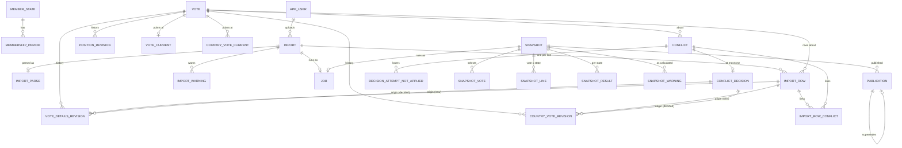

# Database schema

The whole schema is migration 1 (`src/Meridian.Data/Migrations`), so parallel slices add no migrations. The reasoning is in the ADRs: [0001](adr/0001-typed-append-only-revisions.md) (revisions, pointers, guard), [0002](adr/0002-import-classification-and-conflicts.md) (import and conflicts), [0003](adr/0003-job-table-queue-and-blob-files.md) (jobs), [0004](adr/0004-snapshots-store-their-answer.md) (snapshots and publication), [0005](adr/0005-ef-core-rules-in-csharp.md) (data access), [0006](adr/0006-scoring-rules.md) (scoring).

## Conventions

- PostgreSQL 18, EF Core code-first, snake_case names (`EFCore.NamingConventions`).
- **Keys**: `bigint` everywhere. Every guarded table with an `id` takes it from one shared sequence, `history_seq` (`DEFAULT nextval('history_seq')`), so ordering by id gives the true order across tables. Per vote this is exact, because the per-vote lock serialises everything that touches a vote. `job` uses its own identity. Natural keys: `member_state.code char(3)`, `app_user.id text`.
- **Fixed value lists** are `text`:
  - Integrity values (outcome, ballot, stance, weight, subject, decision, category, job state and kind, role) get a database CHECK.
  - Report information (row reason codes, import and snapshot warning kinds) is a C# enum stored as text, with **no** database CHECK. Adding a code needs no migration.
- **Every history row** has `recorded_at timestamptz NOT NULL DEFAULT now()` and names its actor, either directly or through its import or decision.
- 🔒 **Guard**: `refuse_history_change()` runs `BEFORE UPDATE OR DELETE OR TRUNCATE` once per statement (so even a statement matching no row is refused), on every table except ✏️ `job`, ✏️ `vote_current`, ✏️ `country_vote_current` and `__EFMigrationsHistory`. A test proves the guard holds.

- **Built as written, plus**:
  - `import_row.country_vote_revision_id` and `details_revision_id` reference the revision the row created, whose origin is that same row, so these two foreign keys are `DEFERRABLE INITIALLY DEFERRED` and ids are reserved from `history_seq` before inserting.
  - `job.rows_read`, `votes_done` and `attempts` default to 0, so a job can be queued in plain SQL.
  - `snapshot_warning` has `recorded_at` like every history row, and `snapshot_line` reaches its country vote revision through a composite key on (revision, vote, state).
  - `vote_timeline.kind` is one of `import`, `details_revision`, `country_vote_revision`, `position_revision`, `conflict_opened`, `conflict_decided`, `decision_not_applied`, `snapshot`, `publication`.

## Diagram

## Tables

### 1. Reference 🔒 (seeded)

| Table | Columns | Keys, constraints, indexes |
|---|---|---|
| `member_state` | `code char(3)`, `name text` | PK `code`; CHECK `code ~ '^[A-Z]{3}$'` |
| `membership_period` | `id`, `state_code`, `member_from date`, `member_to date NULL` (null = still a member) | FK `state_code`; CHECK `member_to >= member_from`; index `(state_code)`. No overlaps: checked in C# |
| `app_user` | `id text`, `display_name text`, `role text` | PK `id`; CHECK `role IN ('analyst','admin')` |

**Seed**: the `migrate` service runs migrations, then, if `member_state` is empty, loads `/candidate_data/member_states.csv` (mounted read-only) through the same parser rules as imports, and fails loudly if the file is missing. The users `dana`, `omar` (analyst) and `lena` (admin) are inserted by a migration. Tests use committed synthetic member states.

### 2. Ingestion 🔒

| Table | Columns | Keys, constraints, indexes |
|---|---|---|
| `import` | `id`, `file_name`, `blob_name`, `sha256 char(64)`, `size_bytes bigint`, `uploaded_by`, `recorded_at` (upload time) | FK `uploaded_by`; index `(sha256)` (for the "identical to" warning). Written with its job in the upload transaction |
| `import_parse` | `import_id`, `header jsonb` (columns as found), `has_bom bool`, `line_endings text` (`lf`, `crlf`, `mixed`), `data_rows int`, `max_published_at timestamptz NULL`, `rejected_reason text NULL` (missing required column, bad UTF-8, no data rows), `recorded_at` | PK/FK `import_id` (one per import, written when parsing ends; `ON CONFLICT DO NOTHING` on retry). An import is **rejected** when `rejected_reason` is set, and then has no row records |
| `import_row` | `id`, `import_id`, `line_no int`, `raw_text text`, `vote_id NULL`, parsed and normalised fields (`state_code text NULL`, `country_name`, `ballot`, `session int`, `vote_date date`, `title`, `published_at timestamptz`, all `NULL`), `outcome`, `reason_code text NULL`, `reason_message text NULL`, `normalisations jsonb NULL`, `country_vote_revision_id NULL`, `details_revision_id NULL` (the revision this row created or matched), `recorded_at` | UNIQUE `(import_id, line_no)`; CHECK `outcome IN ('new','unchanged','duplicate','invalid','contradiction','conflict')`; indexes `(import_id, outcome)`, `(import_id, vote_id)` (counts, crash resume), `(vote_id)` (timeline). `state_code` is plain text, with no FK, because unknown codes must be stored |
| `import_warning` | `id`, `import_id`, `kind text`, `vote_id NULL`, `detail jsonb`, `recorded_at` | index `(import_id)`. Kinds (C# enum): extra columns, identical file, older `published_at`, incomplete vote (one per vote) |

**Counts** per outcome and per vote are always queried from `import_row`, never stored. `job` counters exist only for live progress.

### 3. Approved data 🔒 history, ✏️ pointers

| Table | Columns | Keys, constraints, indexes |
|---|---|---|
| `vote` | `id`, `assembly_vote_id text`, `first_seen_import_id`, `recorded_at` | UNIQUE `assembly_vote_id`. Created the first time a well-formed id is seen, even when the whole vote is a contradiction. It is the per-vote lock target (`FOR UPDATE` takes a row lock and does not fire the update guard). A vote with no details revision appears only in its timeline, never in vote lists |
| `vote_details_revision` | `id`, `vote_id`, `session int`, `vote_date date`, `title text`, `origin_import_row_id NULL`, `origin_decision_id NULL`, `recorded_at` | CHECK `session > 0`; CHECK `num_nonnulls(origin_import_row_id, origin_decision_id) = 1`; UNIQUE `(id, vote_id)`; index `(vote_id, id)`. No unique index on (title, date): 151 pairs in the historic file are shared by different votes |
| `position_revision` | `id`, `vote_id`, `stance text`, `weight smallint`, `set_by`, `recorded_at` | CHECK `stance IN ('yes','no')`, `weight BETWEEN 1 AND 5`; UNIQUE `(id, vote_id)`; index `(vote_id, id)` |
| `country_vote_revision` | `id`, `vote_id`, `state_code`, `ballot char(1)`, `origin_import_row_id NULL`, `origin_decision_id NULL`, `recorded_at` | FK `state_code → member_state`; CHECK `ballot IN ('Y','N','A','X')`; CHECK exactly one origin; UNIQUE `(id, vote_id, state_code)`; index `(vote_id, state_code, id)` |
| ✏️ `vote_current` | `vote_id`, `details_revision_id`, `position_revision_id NULL` (null = no position yet) | PK `vote_id`; composite FK `(details_revision_id, vote_id)` and `(position_revision_id, vote_id)`, so a pointer can only reach its own vote's revisions |
| ✏️ `country_vote_current` | `vote_id`, `state_code`, `revision_id` | PK `(vote_id, state_code)`; composite FK `(revision_id, vote_id, state_code)`; index `(state_code)` |

**Position concurrency (POS)**: the version is the position revision id. The save is `UPDATE vote_current SET position_revision_id = @new WHERE vote_id = @v AND position_revision_id IS NOT DISTINCT FROM @seen`, and zero rows changed means 409 with the current value. "Previous" for any history is the previous id for the same subject.

A **membership recalculation** (ADR 0002) writes country vote revisions whose origin is the vote-details decision.

### 4. Conflicts 🔒

| Table | Columns | Keys, constraints, indexes |
|---|---|---|
| `conflict` | `id`, `vote_id`, `subject text`, `opened_by_import_id`, ballot side: `state_code NULL`, `incoming_ballot NULL`, `compared_country_vote_revision_id NULL`; details side: `incoming_session NULL`, `incoming_vote_date NULL`, `incoming_title NULL`, `incoming_title_key NULL` (comparison key, ADR 0002), `compared_details_revision_id NULL`; `recorded_at` | CHECK `subject IN ('ballot','details')`; CHECK that the subject's columns are all set and the other side's are all null; composite FKs to the compared revision of the same vote (and state). **ING-12**: partial UNIQUE `(compared_country_vote_revision_id, incoming_ballot) WHERE subject = 'ballot'` and UNIQUE `(compared_details_revision_id, incoming_session, incoming_vote_date, incoming_title_key) WHERE subject = 'details'`. An incoming value that matches an existing conflict against the same approved revision links to it, whether it is pending or decided. A rejected value never reopens; the row gets reason `previously_rejected`. Index `(vote_id)` |
| `import_row_conflict` | `import_row_id`, `conflict_id` | PK both; index `(conflict_id)`. A row can link to two conflicts (details and ballot) |
| `conflict_decision` | `id`, `conflict_id`, `decision text`, `decided_by`, `comment text NULL`, `replaced_country_vote_revision_id NULL`, `replaced_details_revision_id NULL` (the current value at decision time), `recorded_at` | **UNIQUE `conflict_id`** (CON-05: the loser gets 409); CHECK `decision IN ('accept','reject')`. The revision an accept created is found through its `origin_decision_id`, which keeps the foreign keys free of cycles |
| `decision_attempt_not_applied` | `id`, `conflict_id`, `attempted_by`, `attempted text`, `recorded_at` | CHECK `attempted IN ('accept','reject')`; index `(conflict_id)` |

**Pending** = a conflict with no decision (view `pending_conflict`).

### 5. Snapshots and publication 🔒

| Table | Columns | Keys, constraints, indexes |
|---|---|---|
| `snapshot` | `id`, `name text`, `note text NULL`, `selection jsonb` (criteria as entered, including removed votes), `scoring_rules_version text` (the id of the rule set the snapshot was scored under; `matched_weight` and `counted_weight` below are in that rule set's weight points), `created_by`, `recorded_at` | UNIQUE index on `lower(btrim(name))` (every snapshot holds its name, failed ones included; rows that already shared a name when the index came are left out of it by id, since they cannot be renamed). Inserted when requested. Whether it is calculated, running or failed lives on its job |
| `snapshot_vote` | `snapshot_id`, `vote_id`, `details_revision_id`, `position_revision_id` | PK `(snapshot_id, vote_id)`; `position_revision_id NOT NULL` (no position blocks); composite FKs to the same vote's revisions |
| `snapshot_line` | `snapshot_id`, `vote_id`, `state_code`, `country_vote_revision_id NULL` (null = no data), `category text` | PK `(snapshot_id, vote_id, state_code)`; FK `(snapshot_id, vote_id) → snapshot_vote`; CHECK `category IN ('match','mismatch','abstain','absent','non_member','no_data')`; index `(snapshot_id, state_code)` (per-country breakdown) |
| `snapshot_result` | `snapshot_id`, `state_code`, `matched_weight int`, `counted_weight int`, `rank int NULL` | PK `(snapshot_id, state_code)`; CHECK `0 <= matched_weight AND matched_weight <= counted_weight`; CHECK `(rank IS NULL) = (counted_weight = 0)` |
| `snapshot_warning` | `id`, `snapshot_id`, `kind text`, `vote_id NULL`, `detail jsonb` | index `(snapshot_id)`. Kinds are a C# enum: pending conflicts, incomplete vote, calculated during an import |
| `publication` | `id`, `snapshot_id`, `quarter text`, `published_by`, `reason text NULL`, `supersedes_publication_id NULL`, `recorded_at` | CHECK `quarter ~ '^[0-9]{4}-Q[1-4]$'`; CHECK `(supersedes_publication_id IS NULL) = (reason IS NULL)`; UNIQUE `(id, quarter)` + composite FK `(supersedes_publication_id, quarter)` (a replacement stays in its quarter); partial UNIQUE `(quarter) WHERE supersedes_publication_id IS NULL` (one first publication per quarter); partial UNIQUE `(supersedes_publication_id) WHERE NOT NULL` (one successor each). The quarter's published snapshot is the end of its chain. Two admins publishing at once: one hits a unique violation → 409 |

The snapshot job writes votes, lines, results and warnings in its single final transaction.

### 6. Jobs ✏️ (outside the guard)

| Table | Columns | Keys, constraints, indexes |
|---|---|---|
| `job` | `id` (own identity), `kind text`, `import_id NULL`, `snapshot_id NULL`, `state text`, `rows_read int`, `votes_done int`, `votes_total int NULL`, `heartbeat_at NULL`, `attempts int`, `last_error text NULL`, `trace_parent text NULL` (from the request that queued it), `created_at`, `started_at NULL`, `finished_at NULL` | CHECK `kind IN ('import','snapshot')` (later `pdf_extraction`); CHECK `state IN ('queued','running','done','failed')`; CHECK the link matches the kind; UNIQUE `import_id`, UNIQUE `snapshot_id`; partial index `(kind, id) WHERE state = 'queued'` (claim the oldest); partial index `(heartbeat_at) WHERE state = 'running'` (sweeper) |

## Views (raw SQL in migrations, mapped as keyless entities)

- `current_country_vote`: `country_vote_current` joined to its revision (vote, state, ballot, revision id, origin).
- `current_vote`: `vote` + `vote_current` + its details and position revisions. Only votes that have details.
- `pending_conflict`: conflicts with no decision, plus the live current value read through the pointers.
- `vote_timeline`: `UNION ALL` of typed events in common columns `(vote_id, history_id, kind, actor, at, detail jsonb)`:
  - an import touching the vote, with per-vote counts
  - a details, position or country-vote revision, with its origin
  - a conflict opened or decided
  - a decision attempt that was not applied
  - a snapshot that included the vote
  - a publication of such a snapshot

  Paged by `history_id`. "From → to" pairs are built in C#.

## Deliberately not in the schema

- Membership overlap: checked in C#.
- Stored counts per outcome: always queried from the row records.
- A database limit on running imports: a claim-time setting.
- The running app as a non-owner role: a before-production item.
- Vote id format: not validated beyond "not empty". Every real id would pass, and the brief fixes no format.

## Why this shape

- **Three layers and a ledger**: evidence (files, which never change), verdicts (row records, conflicts and decisions, frozen at the moment they were made) and approved data (revisions only ever added, with moving pointers). Only `job` and the two pointer tables ever change.
- **Revisions plus pointers**: no previous value is ever lost (HIS-02). A snapshot stores revision ids, so it reproduces exactly a year later (SNP-04). The race-sensitive code is one locked pointer move.
- **Guard trigger**: "history never changes" is a property of the database, proven by a test, not a team habit.
- **Exactly one origin** per revision (an import row or a decision), so every value can be explained (HIS-01).
- **Unique indexes do the hard concurrency**: one decision per conflict (CON-05, the loser gets 409). One conflict per (compared revision, incoming value) (ING-12): re-imports never reopen, and a rejected value only returns once the approved value has changed.
- **One `history_seq`** orders the timeline across all tables (HIS-04). Per vote this is exact, because of the per-vote lock.
- **Snapshots store categories and revision ids**, so neither later data nor later scoring code can change an old breakdown. Publications form an insert-only chain of replacements, each with a reason.
- **Rule of thumb**: if breaking a rule would make a published number wrong or unexplainable, the database enforces it. Presentation and policy (reason codes, warning kinds, how many imports run at once, membership overlap) live in C#.
- **Worked example (Brazil, vote 101)**: r1 = Y from import #1; snapshot "2024-Q1" records r1. Rev2 opens conflict #7 against r1. Dana's accept wins and Omar's attempt is recorded as not applied. r2 = A (origin: decision #7) and the pointer moves. A rev2 re-upload is unchanged. "2024-Q1" still shows r1 = Y.
